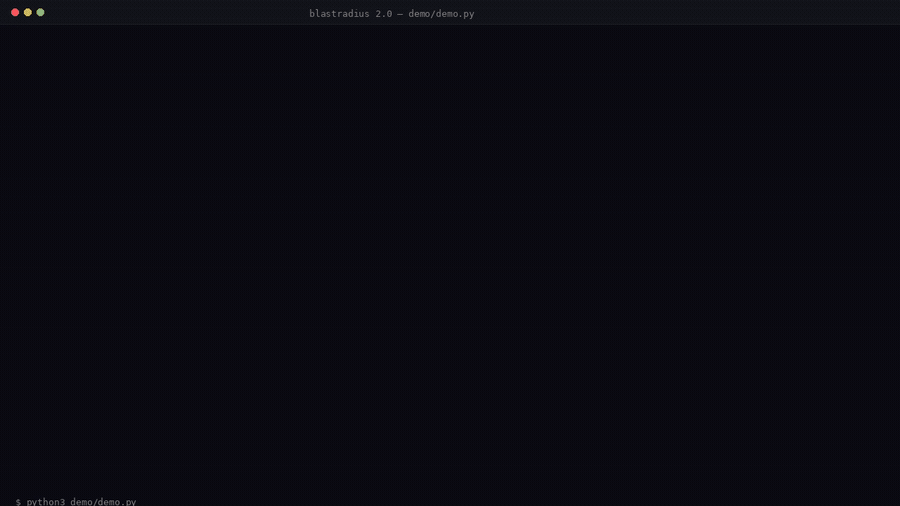

# Blast Radius 2.0

**Know what breaks before your agent does, and keep a way back.**

A Hermes Agent plugin that measures a destructive command's real target, copies it into a
checksummed snapshot before it runs, and restores it afterwards when something goes wrong.



<sub>43 files measured → snapshot verified → command runs → files restored, checksums checked.
Full 35s MP4: [demo/blastradius-demo.mp4](demo/blastradius-demo.mp4) ·
text transcript: [demo/DEMO-OUTPUT.txt](demo/DEMO-OUTPUT.txt)</sub>

```bash
hermes plugins install https://github.com/valenciayuna/hermes-plugin-blastradius
hermes plugins enable blastradius
```

**Requirements:** Python 3.10+ and a Hermes build with the plugin hook API (`pre_tool_call`,
`register_tool`, `register_command`). No third-party Python packages; the tests run on the
standard library alone. `git` is used for tracked/untracked analysis when the target is a repo.

---

## Why it exists

Hermes already asks "allow this command?" and can ask a model "is this dangerous?". Neither
answers the useful question: **what dies if I say yes?** A risk opinion is formed from the
command text; it never opens the target.

Blast Radius opens it. It expands the paths, walks them, and splits the result into files git
can restore and files it cannot. `git clean -fd`, an uncommitted `.env`, a local database: all
untracked, all invisible to a guess about the command string.

---

## What it does

### 1. Impact report

```
BLASTRADIUS // IMPACT REPORT

Command: "rm -rf ."

Impact:
  43 file(s) affected
  7 tracked by git
  36 untracked (2 ignored)
  29.4 KB affected

Potentially valuable data:
  ".env"
  "data/app.db"
  "migrations/0007_draft.sql"

Recovery:
  Git-tracked files may be recoverable from the repository.
  Untracked files are not recoverable from Git.

Risk level: HIGH
```

### 2. Recursive parsing

A wrapped command is not a blind spot anymore. The parser splits on `&&`, `||`, `;`, `|` and
newlines while respecting quotes, unwraps `bash -c` / `sh -lc` strings and `( … )` / `{ …; }`
groups, and follows `cd` inside the chain so later relative paths resolve from the right place.

```bash
bash -c "cd build && rm -rf ."     # measures build/, not nothing
sh -c 'bash -c "rm -rf data"'      # nested wrapper, still measured
```

Still reported as **unmeasured** instead of guessed: command substitution (`$(…)`, backticks),
unresolved variables, `ssh`, `eval`/`source`, and dynamic `xargs`. When only part of a chain can
be seen, the report says so. `balanced` and `relaxed` block with a *partial measurement*
warning rather than passing quietly, and `strict` blocks outright.

Recursion depth is capped at 3 wrappers.

### 3. Verified snapshots

Before the command runs, every affected regular file is copied outside the target tree with a
SHA-256 each, then re-read to confirm the copy matches.

- stored under `~/.hermes/plugin-data/blastradius/snapshots/<id>/` (0700 dirs, 0600 files)
- symlinks are recorded but **not followed**
- the store is outside the target, so the destructive command cannot eat it
- rebuildable directories (`node_modules`, `.venv`, `venv`, `__pycache__`, `.git`, `dist`,
  `build`, `.next`, caches) are **not copied**: they are counted in the report and listed as
  `not snapshotted (excluded)`. `--include` overrides this per snapshot.
- free space is checked first; a failed snapshot is reported as failed and blocks under `strict`

### 4. Restore with conflict detection

```
/blast restore last            # plan only
/blast restore last confirm    # apply, then verify
```

Refuses to restore from a snapshot that fails its own verification.

A file that changed after the snapshot is a **conflict**, and conflicts are skipped, not written
over: the newer file is usually the work you were doing. The plan and the result both report the
count and the first ten paths. Replacing them is possible but has to be asked for:

```json
{"snapshot_id": "last", "confirm": true, "overwrite_conflicts": true}
```

Every restore is logged to `recovery.log` and marks the snapshot as recently used.

Snapshots of paths outside the git root (for example `rm -rf /tmp/build` run inside a repo) are
stored under an `abs/` prefix with the absolute path, and restore puts them back where they came
from.

### 5. Retention

Defaults keep the store bounded without asking: **14 days**, **20 snapshots**, **2048 MB**.
Pruning runs automatically before a snapshot is created, oldest first, and never touches a
snapshot that is pinned or was restored in the last 24 hours.

```
/blast prune            # plan
/blast prune confirm    # apply
/blast pin <id>         # exempt from retention
/blast unpin <id>
```

Limits are overridable per environment: `BLASTRADIUS_SNAP_MAX_AGE_DAYS`,
`BLASTRADIUS_SNAP_MAX_COUNT`, `BLASTRADIUS_SNAP_MAX_TOTAL_MB`.

### 6. Risk policies

| Policy | Behaviour |
|---|---|
| `relaxed` | report the impact, block high-impact changes or any partially measured call |
| `balanced` *(default)* | block when untracked data would not be recoverable from git, or when part of the command is invisible |
| `strict` | block every measured destructive call until a verified snapshot exists; `blast_allow` creates one and withholds the grant if it fails |

```
/blast policy            # show
/blast policy strict     # set
BLASTRADIUS_POLICY=relaxed hermes ...
```

---

## Tools and commands

| Interface | What it does |
|---|---|
| `blast_radius(command, cwd?)` | measure impact without running anything |
| `blast_snapshot(command, cwd?, include_excluded?)` | back up the targets and verify the copies |
| `blast_snapshots()` | list snapshots with size, verification, pin state, exclusions |
| `blast_restore(snapshot_id?, confirm?)` | plan or apply a restore |
| `blast_allow(command, ttl_s?)` | permit exactly one future execution (spent on use) |
| `blast_policy(policy?)` | read or set the risk policy |
| `blast_prune(confirm?)` | apply retention limits |
| `blast_pin(snapshot_id?, pinned?)` | pin or unpin a snapshot |
| `/blast <command>` | shorthand impact report |
| `/blast snapshot <cmd>` · `snapshots` · `restore [id] [confirm]` · `prune [confirm]` · `pin`/`unpin [id]` · `policy [name]` | the same actions from chat |

`BLASTRADIUS_ALLOW=1` remains the operator's blanket override for a session.

---

## Security model

The agent is treated as **careless, not adversarial**. A command typo, a wrong path or a
misunderstood instruction is the threat this plugin defends against; an attacker who already
runs commands as your user is not.

What that means in practice:

- A snapshot is a plain copy in your home directory. Anyone who can read your files can read the
  snapshot (it is 0600, but same-user processes are not isolated from each other), and anything
  with write access to `~/.hermes/plugin-data` can tamper with it. Verification catches
  corruption of a stored copy, not a determined attacker with your permissions.
- Snapshots do not survive a compromised machine, disk failure, or `rm -rf ~`.
- The hook does not bypass Hermes approval; it only adds a measured block before it.
- The parser is heuristic. Every case it cannot follow is reported as unmeasured, and the plugin
  never approves a command on its own.

---

## Install and verify

```bash
git clone https://github.com/valenciayuna/hermes-plugin-blastradius
cd hermes-plugin-blastradius

python3 tests/blast_proof.py      # 80 checks, isolated temp repos
python3 tests/audit_parser.py     # 16 adversarial command shapes
python3 tests/audit_snapshot.py   # 12 snapshot, restore and policy checks
python3 tests/audit_integration.py  # 7 Hermes dispatcher checks
python3 demo/demo.py             # protect -> destroy -> restore transcript
hermes plugins validate .
hermes plugins doctor .
```

The suite builds a real git repository with generated files, tracked and untracked data, a
`.env`, a SQLite file, a draft migration and a `build/` directory, then exercises measurement,
recursive parsing (nesting, quoting, `cd`, depth limit, unresolvable segments), the gate,
one-shot authorisation, snapshots, exclusion, restore, conflicts, corrupted snapshots, retention
by age/count/size, pinning, and all three policies. Nothing destructive touches the project
directory itself.

---

## Honest limitations

- **Heuristic parsing.** Wrappers and chains are followed up to depth 3; anything genuinely
  opaque is reported as unmeasured, never estimated.
- **No universal undo.** Restore covers regular files that were in a snapshot. Database state,
  remote operations, blockchain transactions and external services are out of scope.
- **Race window.** The filesystem can change between analysis and execution; there is no lock. A
  file created between snapshot and delete is not protected.
- **Excluded directories are not recoverable from the snapshot.** They are listed in the report
  precisely so nobody assumes otherwise.
- **Hard links and special files** are counted but not archived.
- **Snapshots cost disk.** Retention keeps it bounded, but a large target still needs room; a
  snapshot that cannot complete blocks the command under `strict`.

---

## Layout

```
__init__.py                 entry point: registers the hook, tools and /blast command
blastradius_core/
  paths.py                  data dirs, retention config, default excludes
  measure.py                shell-aware parsing, recursive expansion, impact report
  snapshot.py               create/verify/list/pin/prune, checksums, exclusion
  recovery.py               restore planning/apply, allow-grant store
  policy.py                 relaxed / balanced / strict
  hooks.py                  pre_tool_call, tool handlers, command dispatcher
tests/blast_proof.py        80 assertions, stdlib only
tests/audit_parser.py       16 adversarial parser checks
tests/audit_snapshot.py     12 snapshot, restore and policy checks
tests/audit_integration.py   7 dispatcher checks
docs/audit.md               what the audit found, including two fixed bugs
demo/demo.py                end-to-end demo, real deletes and real restores
```

MIT.
